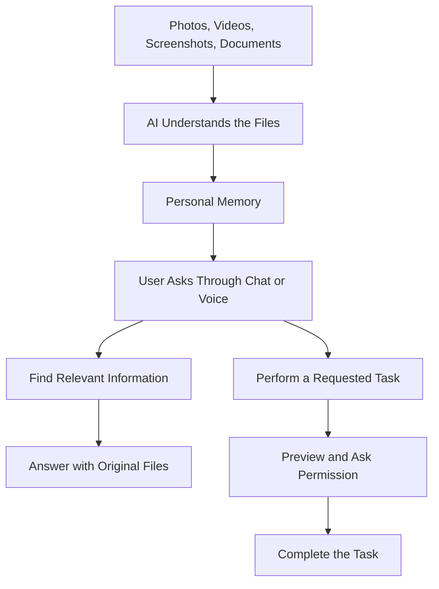
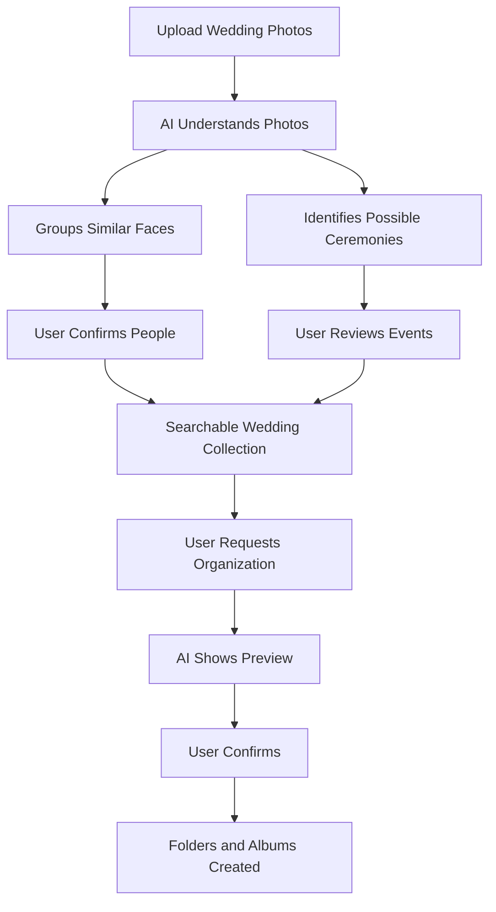

# Project Idea: Personal AI Memory & Action Assistant

## 1. What is this product?

A personal AI assistant that understands the information stored across a user's photos, videos, screenshots, documents, tickets, receipts, business cards, and voice recordings.

Instead of manually searching through thousands of files, users can simply ask questions or give instructions through **chat or voice**.

The system finds relevant information, explains what it found, and can perform useful tasks—with the user's permission.

**In simple words:** Your personal AI that remembers what's inside your digital files, helps you find it, and gets things done.

## 2. How will it work?



## 3. Main Features

### A. Upload and Understand Files

- Upload individual files or large collections.
- Support photos, screenshots, videos, PDFs, documents, and audio.
- Automatically extract useful information.
- Keep original files safe.
- Show upload and processing progress.

### B. Recognize and Organize People

- Find faces that appear to belong to the same person.
- Group similar faces across photographs.
- Allow users to confirm names such as Father, Mother, Brother, or Friend.
- Allow users to correct or remove incorrect groups.
- Find all photographs of a selected person.

_Important: AI can suggest similar faces, but users must confirm a person's identity and relationship._

### C. Understand Events and Memories

- Identify events such as weddings, birthdays, trips, and celebrations.
- Group photographs by ceremonies such as Haldi, Mehendi, Sangeet, Varmala, and Reception.
- Connect people, places, dates, and events.
- Build timelines of important memories.
- Understand user interests and preferences, allowing users to review and correct them.

### D. Search and Ask Questions

Users can ask questions in normal language:

- "Show me all pictures with my father."
- "Find my photos from my brother's Haldi ceremony."
- "On which date did I book my last movie ticket?"
- "Find the phone number of XYZ store from its business card."
- "Show me the receipt for my laptop."
- "What places have I visited with my family?"
- "What are my interests?"

The system should show the answer along with the original files used as evidence. If it is unsure, it should say so instead of guessing.

### E. Perform Tasks for Users

The system should do more than search. It should also:

- Create folders or albums for a selected person.
- Organize photographs by event or ceremony.
- Create collections of selected photographs.
- Find and prepare documents, tickets, and receipts.
- Generate downloadable albums.
- Summarize groups of files.

Before moving, deleting, sharing, or making important changes, the system must ask for permission.

### F. Chat and Voice Assistant

- Ask questions by typing or speaking.
- Receive text or spoken answers.
- Ask follow-up questions naturally.
- Give instructions such as "Find my wedding photos and create a folder."
- Interrupt, cancel, or confirm an action.

The voice assistant will use the same memory and task system as chat.

## 4. Example: Wedding Photo Organization

Suppose a user uploads 2,500 mixed photographs from a wedding.



Example output:

```text
Brother's Wedding
│
├── People
│   ├── Bride
│   ├── Groom
│   ├── Father
│   ├── Mother
│   └── Friends
│
└── Ceremonies
    ├── Haldi
    ├── Mehendi
    ├── Sangeet
    ├── Varmala
    ├── Wedding
    └── Reception
```

A photograph can belong to multiple collections. For example, a photograph of the user's mother during Haldi can appear in both the **Mother** and **Haldi** folders.

## 5. How the Memory System Works


The system should remember not just individual files, but also how information is connected.

For example:

- A person appears in a photograph.
- That photograph belongs to a wedding.
- The wedding happened on a particular date.
- The person has a user-confirmed relationship with the user.

These connections help the system answer more meaningful questions.

## 6. Privacy and User Control

Personal files can contain sensitive information. Therefore:

- Each user's files and memories must remain private.
- Users decide what to upload.
- Users can review and correct extracted information.
- Users can delete files and associated memories.
- Files must never be shared without permission.
- Important actions require user confirmation.
- Answers should show their original sources wherever possible.

## 7. Who Can Use This Product?

- **Individuals and families:** Find personal photographs, documents, bookings, and memories.
- **Photographers:** Organize large wedding and event photo collections for clients.
- **Professionals:** Find saved business cards, receipts, documents, and other information.

The first version will focus on individual users and a real wedding-photo collection. Photographer-focused features can be expanded later.

## 8. Development Plan

1. **First:** Upload photographs, understand them, group similar faces, and classify wedding ceremonies.
2. **Next:** Let users confirm identities and search photographs by person or ceremony.
3. **Then:** Create albums and folders, and answer questions using uploaded files.
4. **Expand:** Add screenshots, PDFs, tickets, receipts, and business cards.
5. **Later:** Add videos, audio, and a voice assistant.
6. **Long term:** Support more everyday tasks and additional personal data sources.

## 9. Product Vision

Build a trusted personal AI memory assistant that understands a user's digital life—not just stores files.

A user should be able to ask:

**"I know I saved this somewhere. Can you find it for me?"**

Or simply say:

**"Please take care of this for me."**

The system should find the right information, explain its answer, and complete permitted tasks safely.

---

_This document describes the product idea and intended features. The first release will focus on reliable photo organization and search before expanding to all media types and voice._
