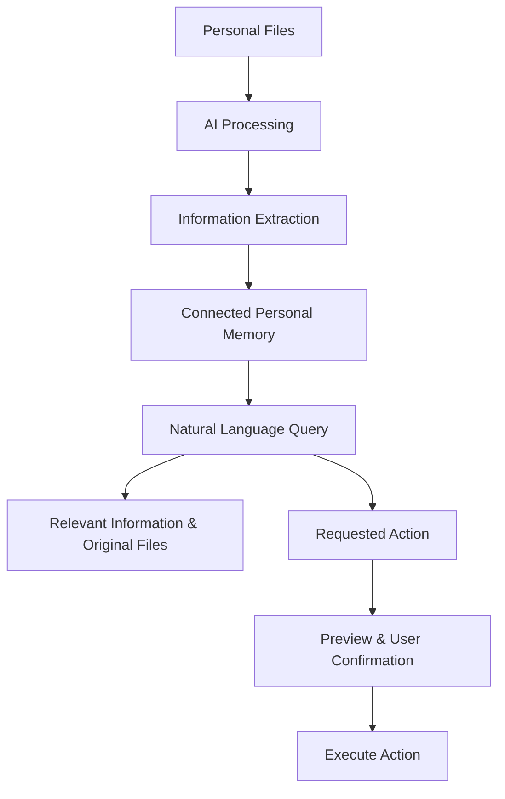

# Memora AI — Personal AI Memory & Action Assistant

A multimodal AI-powered personal memory assistant that understands your digital life. Organize photos, videos, documents, screenshots, and voice recordings into connected memories — then search, recall information, and perform tasks using natural language or voice.

> **Your Life. Your Memories. Your AI.**

## Overview

People store thousands of personal files across devices, folders, and applications. Finding a particular photograph, document, booking detail, or important piece of information often means searching manually.

Memora AI aims to solve this by turning scattered digital files into an interconnected, searchable personal memory system.

Instead of simply storing files, it aims to understand what's inside them, identify meaningful connections, retrieve relevant information, and help users take action.

## Key Capabilities

The following capabilities define the product vision and will be developed progressively.

- **Multimodal File Understanding:** Upload and understand photographs, screenshots, videos, PDFs, documents, tickets, receipts, business cards, and audio recordings.
- **People Recognition:** Group photographs containing similar faces and allow users to confirm identities and relationships.
- **Event Intelligence:** Identify events and organize photographs by occasions and ceremonies such as weddings, Haldi, Mehendi, Sangeet, and Reception.
- **Connected Personal Memory:** Connect people, places, dates, events, documents, and extracted information.
- **Natural Language Search:** Find personal information by asking questions in everyday language.
- **AI-Powered Actions:** Create albums, organize collections, prepare documents, and perform other user-requested tasks.
- **Chat and Voice Assistant:** Interact with the same memory and task system through text or voice.

## How It Works

Memora AI aims to provide answers with links to their original source files whenever possible. When information is uncertain, the system should communicate that rather than guess.

## Initial Focus: Wedding Photo Intelligence

The first major use case is organizing large wedding photo collections.

Given thousands of mixed photographs, the system aims to:

- Group photographs containing the same people.
- Identify possible wedding ceremonies and events.
- Allow users to confirm people and review event classifications.
- Organize photographs into searchable collections.
- Create albums based on people, ceremonies, or occasions.

A photograph can belong to multiple collections. For example, a photograph of someone's mother during the Haldi ceremony can appear in both the **Mother** and **Haldi** collections.

This provides a practical starting point for building a broader personal memory assistant.

## Technology Stack

| Layer                      | Technology                                            |
| -------------------------- | ----------------------------------------------------- |
| Frontend                   | React, TypeScript, Vite                               |
| Styling                    | Tailwind CSS                                          |
| Backend                    | Node.js, Express, TypeScript                          |
| Database                   | PostgreSQL                                            |
| Authentication             | Firebase Authentication                               |
| File Storage               | Local storage initially; cloud object storage planned |
| AI & Multimodal Processing | Python, OpenCV, InsightFace, PaddleOCR, FFmpeg        |
| Background Jobs            | Redis, BullMQ                                         |
| AI Integration             | LLM APIs and custom tool-calling workflows            |

_Technologies will be integrated progressively as the project evolves._

## Development Roadmap

1. **Project Foundation:** Frontend and backend setup, PostgreSQL configuration, authentication, and media upload management.
2. **Media Intelligence:** Image processing, face grouping, and wedding ceremony classification.
3. **Memory & Organization:** User-confirmed identities, searchable events, and connected memories.
4. **AI Search:** Natural language questions and evidence-based answers using uploaded files.
5. **Action Assistant:** Album creation, file organization, document preparation, and task execution.
6. **Multimodal Expansion:** Screenshots, PDFs, videos, audio, and voice-based interactions.

## Core Principles

- **Privacy First:** Personal files and memories must remain private and isolated between users.
- **User Control:** Users can review, correct, and delete their information.
- **Human Confirmation:** AI-suggested identities and relationships must be confirmed by users.
- **Evidence-Based Answers:** Responses should reference original files whenever possible.
- **Safe Actions:** Important operations, especially deletion, sharing, and file changes, require user permission.
- **Progressive Development:** Build reliable foundations before introducing complex AI capabilities.

## Project Status

<code>Under Active Development</code>

Currently focused on the foundational infrastructure, database setup, authentication, and media management. AI-powered processing, memory creation, search, and action capabilities are planned development milestones.

## Research & Documentation

For the detailed product concept, use cases, workflows, and research:

[Read the Project Idea & R&D](https://github.com/Sakshij2810/Personal-AI-Memory-Action-Assistant/blob/main/R%26D/Research/project-idea.md)

---

## Project Setup

For the detailed project setup:

[Visit the Setup folder](https://github.com/Sakshij2810/Personal-AI-Memory-Action-Assistant/tree/main/R%26D/Notes/setup)

---

**Memora AI — Building a trusted AI that doesn't just store your digital life, but understands it.**
